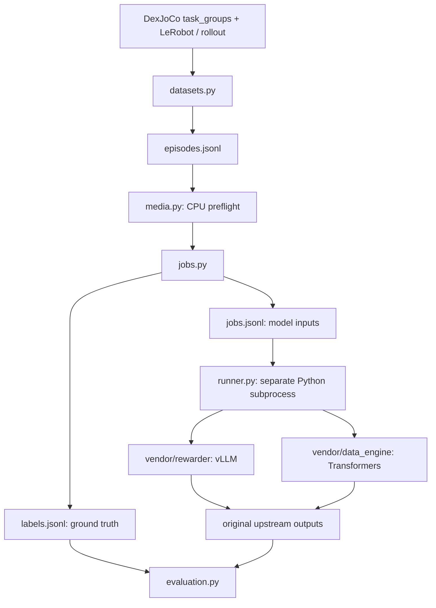

# 代码架构与数据契约

## 分层与职责



`physwam_flora` 只负责数据和进程编排；所有视频采样、mosaic、原生提示词、模型加载、生成、时序拼接与评分解析都调用 `vendor`。唯一在送入模型前改变视频容器的操作是 v3 的 episode 提取：共享文件不符合官方“一条 episode 一个视频文件”的接口，必须按元数据分离。该转换保留帧数/帧率，以 episode 起点归零，并记录原始 offset。

## 输入清单

`episodes.jsonl` 一行一个 episode，示意：

```json
{"id":"pick_bucket_ep000001","task_name":"pick_bucket","instruction":"Place the boxed food into the bucket and then lift the bucket.","robot":"single_arm","episode_index":1,"fps":30,"frames":1800,"cameras":{"base":"/absolute/front.mp4","wrist":"/absolute/wrist.mp4"},"success":null,"source":{"kind":"lerobot"}}
```

路径也可相对 manifest 文件所在目录。手工输入必须至少包含 `id`、`instruction` 和带 `base` 的 `cameras`。`success` 只能是 bool 或 null。不得用 `score` 等模型预测反填成功真值。

为其他策略制作 manifest 后，可以直接传给 `run`；也可通过配置 `source: {kind: manifest, path: ...}` 使用 `prepare` 归档。

## LeRobot 数据选择

`source.root/<task.dataset>/meta/info.json` 决定版本与 video_path 模板。任务组路径沿用工作区现有结构。

- v2：`meta/episodes.jsonl` 的 `episode_index`/`length`，`chunks_size` 与 `video_path` 模板定位 MP4。
- v3：`meta/episodes/**/*.parquet` 的 `videos/<feature>/{chunk_index,file_index,from_timestamp,to_timestamp}` 定位共享视频及 episode 区间。逐相机提取后验证 frame count；不读取 action/state，也不依赖完整 LeRobot 包。
- `source.episodes`：显式 episode index 列表，不存在的 index 报错。
- `source.limit_per_task`：对选中的 index 排序后截取数量，仅用于初跑。
- 数据集任务指令来自 task_groups；FastWAM rollout 优先使用真实评测的 environment.yaml 快照。

只有 constant-rate 视频支持当前 Rewarder 适配。官方 Human 单视角路径可以处理 VFR，但本框架针对 DexJoCo 统一要求 CFR，避免 Rewarder 把帧索引误当真实时间。多相机有相同相对帧时钟是前提，光靠视频无法证明硬件拍摄同步。

## 相机输入契约

| 输入 | Rewarder 视频列表 | Captioner |
|---|---|---|
| 单主视角 | `[base]` | `video=base` |
| 单臂两视角 | `[base, wrist]` | 默认主视角，绝不复制腕相机伪造三视角 |
| 双臂三视角 | `[wrist_left, base, wrist_right]` | `video=base, left_wrist=..., right_wrist=...` |

Rewarder 两路的左右顺序是视觉布局约定，DexJoCo 的主相机/腕相机未必与原训练机位相同；需用样本检查域差异。三路顺序按官方 left/center/right。Captioner 的实际拼图交给原生 profile 处理。

## 执行边界

`runner.make_plan` 只检查清单、组装命令，不读 GPU、不下载、不写输出。`runner.run` 先校验全部源码 checksum 和视频，再写 jobs/labels/run 快照并创建独立子进程。CUDA_VISIBLE_DEVICES 只传给子进程。

一个 run 对应一个 stage。Rewarder 每个 stage 会建立独立模型服务；Captioner 使用官方逐 episode 的完整流水线，模型加载/卸载和缓存复用策略保持上游行为。JSONL 顺序处理不代表跨 episode 的 GPU 动态批处理。

控制层可使用 Python 3.11+，原生推理环境按官方 Python 3.12 安装。保留 venv python 的符号链接路径，不能 resolve 到系统 Python。两套依赖和同名 `batch_utils` 通过进程和工作目录隔离。

`run.json` 记录模型作业以外的成功标签、数据来源、配置和源码版本；这个文件不会传入模型。原生输出不重写。运行中断保留已有结果和日志；不存在隐式续跑/覆盖，避免同一个目录混入两种配置。

## 扩展方式

1. 新数据来源：在 `datasets.py` 增加转换到同一 episode schema 的适配器。
2. 新 rubric：提供任务明确的 JSON 评分表，登记到 `rubric.files`。
3. 新评测：读取官方原始输出，在 `evaluation.py` 添加离线指标，不能把真值传给生成模型。
4. 上游升级：固定新 commit、比较源码/依赖/模型 revisions、更新 `sources.lock.json` 后重跑契约测试。不要直接改 `vendor` 的 prompt 或精度逻辑。

当前未实现长于 120 秒的 Captioner 自动分段及跨段事件合并，也没有策略训练、在线 reward、GPU 批量调度或生成式重试封装。超限输入会在加载模型前报错。
